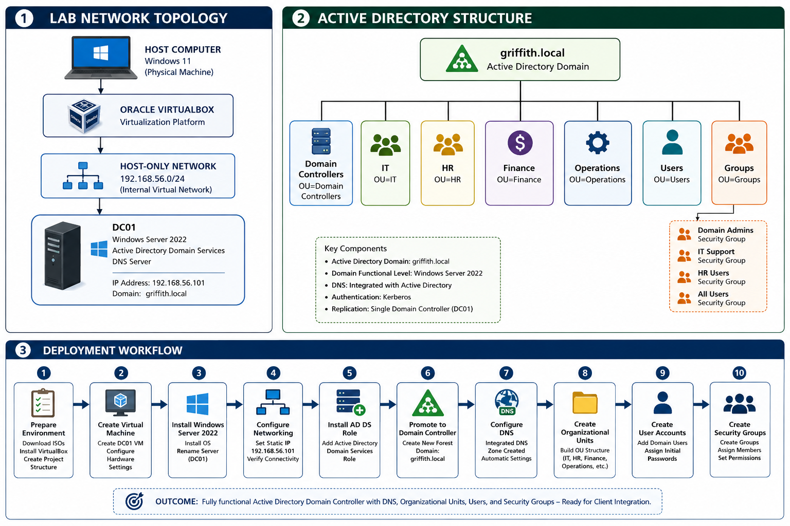

# Enterprise Active Directory Domain Controller Deployment

> **Windows Server 2022 • Active Directory Domain Services (AD DS) • DNS • Oracle VirtualBox • Windows Systems Administration • Enterprise Infrastructure Documentation**


---

# Enterprise Windows Infrastructure Project

This repository documents the successful design, deployment, configuration, and documentation of a **Windows Server 2022 Active Directory Domain Controller** within an isolated enterprise lab environment using **Oracle VirtualBox**.

The project demonstrates practical experience deploying enterprise Windows infrastructure, including **Active Directory Domain Services (AD DS), DNS, static IPv4 networking, Organizational Units (OUs), user administration, security groups, virtualization, and technical documentation**.

The objective was not simply to install Windows Server, but to build a repeatable enterprise deployment while documenting every stage of the implementation using professional GitHub documentation practices.

---

# Table of Contents

- [Technical Skills Demonstrated](#technical-skills-demonstrated)
- [Technologies Used](#technologies-used)
- [Project Objectives](#project-objectives)
- [Lab Environment](#lab-environment)
- [Enterprise Lab Architecture](#enterprise-lab-architecture)
- [Deployment Workflow](#deployment-workflow)
- [Repository Structure](#repository-structure)
- [Documentation](#documentation)
- [Deployment Evidence](#deployment-evidence)
- [Project Outcomes](#project-outcomes)
- [Lessons Learned](#lessons-learned)
- [Future Enhancements](#future-enhancements)
- [About the Author](#about-the-author)
- [License](#license)

---

# Technical Skills Demonstrated

This project demonstrates practical experience with:

- Windows Server 2022 Administration
- Active Directory Domain Services (AD DS)
- DNS Administration
- Oracle VirtualBox
- Virtual Machine Deployment
- Enterprise Networking
- IPv4 Configuration
- Static IP Addressing
- Active Directory Forest Deployment
- Organizational Unit (OU) Design
- User Administration
- Security Group Administration
- Infrastructure Documentation
- Technical Troubleshooting
- Git Version Control
- GitHub Portfolio Development

---

# Technologies Used

| Category | Technology |
|-----------|------------|
| Operating System | Windows Server 2022 |
| Virtualization | Oracle VirtualBox |
| Directory Services | Active Directory Domain Services |
| Name Resolution | Microsoft DNS |
| Networking | IPv4 / Static IP Addressing |
| Documentation | Markdown |
| Version Control | Git |
| Repository | GitHub |

---

# Project Objectives

The primary objectives of this project were to:

- Deploy Windows Server 2022
- Configure Oracle VirtualBox
- Configure enterprise-style networking
- Assign static IPv4 addressing
- Install Active Directory Domain Services
- Promote the server to a Domain Controller
- Create a new Active Directory Forest
- Configure integrated DNS
- Create Organizational Units (OUs)
- Create domain users
- Create security groups
- Build enterprise-quality technical documentation
- Develop a professional GitHub portfolio project

---

# Lab Environment

## Domain Controller

| Configuration | Value |
|--------------|-------|
| Hostname | DC01 |
| Operating System | Windows Server 2022 |
| Domain | griffith.local |
| IPv4 Address | 192.168.56.101 |
| Hypervisor | Oracle VirtualBox |
| Network Type | Host-Only |

---

# Enterprise Lab Architecture

The diagram below illustrates the complete lab environment, including the virtualization platform, network topology, Active Directory structure, DNS integration, and deployment workflow.

> **Location:** `diagrams/Enterprise-Architecture.png.png`



---

# Deployment Workflow

The deployment followed a structured enterprise implementation process.

## Phase 1 — Environment Preparation

- Download Windows Server installation media
- Install Oracle VirtualBox
- Configure project workspace
- Prepare virtualization environment

Reference Screenshots

- 01-Operating-System-ISOs.png
- 02-VirtualBox-Installed.png
- 03-VirtualBox-Storage-Location.png

---

## Phase 2 — Virtual Machine Deployment

- Create DC01 virtual machine
- Configure virtual hardware
- Configure storage
- Configure networking

Reference Screenshots

- 06-Create-DC01-VM.png
- 06-DC01-Hardware-Settings-1.png
- 07-DC01-Hardware-Settings-2.png
- 08-DC01-Virtual-Disk.png
- 09-DC01-Created.png
- 10-DC01-Network-Adapters.png

---

## Phase 3 — Windows Server Installation

- Install Windows Server 2022
- Rename server to DC01
- Configure static IPv4 addressing
- Verify network connectivity

Reference Screenshots

- 11-Windows-Server-Installing.png
- 12-DC01-Desktop.png
- 13-DC01-Renamed.png
- 14-DC01-Static-IP.png
- 15-DC01-Static-IP-Verification.png

---

## Phase 4 — Active Directory Deployment

- Install Active Directory Domain Services
- Promote server to Domain Controller
- Configure integrated DNS
- Create Active Directory Forest

Reference Screenshots

- 16-ADDS-Role-Installed.png
- 17-Domain-Controller-Created.png
- 18-Active-Directory-Domain.png

---

## Phase 5 — Directory Administration

- Create Organizational Units
- Create User Accounts
- Create Security Groups

Reference Screenshots

- 19-Organizational-Units.png
- 20-Security-Groups.png
- 21-User-Accounts.png

---

## Phase 6 — Client Preparation

A Windows 11 virtual machine was prepared for future enterprise expansion. During testing it was determined that **Windows 11 Home** does not support joining an Active Directory domain. Future enhancements include deploying a Windows 11 Pro client for complete domain integration.

Reference Screenshots

- 22-Windows11-VM-Creation.png
- 23-Windows11-Hardware.png
- 24-Windows11-Network.png
- 25-Windows11-Desktop.png

---

# Repository Structure

The repository is organized to separate documentation, diagrams, screenshots, and supporting resources for easy navigation.

```text
active-directory-domain-controller-lab
│
├── docs
│   ├── Project-Overview.md
│   ├── Environment-Setup.md
│   ├── Architecture.md
│   ├── Networking.md
│   ├── Active-Directory.md
│   ├── DNS.md
│   ├── User-Management.md
│   ├── Troubleshooting.md
│   ├── Lessons-Learned.md
│   └── Future-Enhancements.md
│
├── diagrams
│   └── Enterprise-Architecture.png
│
├── screenshots
│
├── scripts
│
├── LICENSE
│
└── README.md
```

---

# Documentation

Detailed documentation for each phase of the deployment is available in the **docs** directory.

| Document | Description |
|----------|-------------|
| [Project Overview](docs/Project-Overview.md) | High-level overview of the project |
| [Environment Setup](docs/Environment-Setup.md) | Hardware, software, and virtualization configuration |
| [Architecture](docs/Architecture.md) | Enterprise architecture and infrastructure design |
| [Networking](docs/Networking.md) | Host-Only networking, IPv4, and DNS configuration |
| [Active Directory](docs/Active-Directory.md) | Active Directory deployment and configuration |
| [DNS](docs/DNS.md) | DNS implementation and verification |
| [User Management](docs/User-Management.md) | Organizational Units, users, and security groups |
| [Troubleshooting](docs/Troubleshooting.md) | Deployment issues and resolutions |
| [Lessons Learned](docs/Lessons-Learned.md) | Technical concepts reinforced during the project |
| [Future Enhancements](docs/Future-Enhancements.md) | Planned expansion of the lab |
| [Build Checklist](docs/Build-Checklist.md) | Condensed step by step deployment checklist |
| [Hardening Guide](docs/Hardening.md) | Group Policy hardening, audit policy, and service lockdown for the domain |

---

# Deployment Evidence

The entire deployment has been documented with screenshots demonstrating each major milestone.

| Deployment Phase | Screenshot Location |
|------------------|--------------------|
| Environment Preparation | `screenshots/01-03` |
| Virtual Machine Creation | `screenshots/06-10` |
| Windows Server Installation | `screenshots/11-15` |
| Active Directory Deployment | `screenshots/16-18` |
| Organizational Units | `screenshots/19` |
| Security Groups | `screenshots/20` |
| User Accounts | `screenshots/21` |
| Windows 11 Client Preparation | `screenshots/22-25` |

These screenshots provide visual evidence of each implementation phase and support the accompanying technical documentation.

---

# Project Outcomes

Upon completion of this project, the following capabilities were successfully demonstrated:

- Deployment of Windows Server 2022
- Enterprise virtualization using Oracle VirtualBox
- Static IPv4 network configuration
- Installation and configuration of Active Directory Domain Services
- Deployment of an Active Directory Forest
- Configuration of integrated Microsoft DNS
- Organizational Unit (OU) design
- User account administration
- Security group administration
- Enterprise-style infrastructure documentation
- Structured troubleshooting methodology
- Professional GitHub project organization

---

# Key Concepts Reinforced

This project strengthened practical knowledge in several core infrastructure areas.

### Windows Server Administration

- Server deployment
- Initial configuration
- Infrastructure planning
- Server role installation

### Active Directory

- Forest creation
- Domain Controllers
- Organizational Units
- User administration
- Security groups

### DNS

- Name resolution
- Active Directory integration
- Service discovery
- DNS verification

### Networking

- IPv4 addressing
- Static IP configuration
- Host-Only networking
- Connectivity verification

### Virtualization

- Oracle VirtualBox
- Virtual hardware
- Virtual storage
- Network adapters

### Documentation

- Enterprise documentation
- GitHub repository organization
- Deployment procedures
- Technical writing

---

# Lessons Learned

Completing this project reinforced several important enterprise concepts.

- Active Directory depends heavily on DNS.
- Infrastructure servers should always use static IP addresses.
- Proper planning reduces deployment complexity.
- Organizational Units improve administration and scalability.
- Security groups simplify access management.
- Documentation is essential for repeatable deployments.
- Structured troubleshooting is more effective than trial-and-error.

These lessons directly apply to Windows Server administration, enterprise IT operations, help desk support, and cybersecurity environments.

---

# Future Enhancements

This repository will continue to expand with additional enterprise Windows technologies.

Planned future phases include:

- Windows 11 Pro Domain Client
- Domain Join
- Group Policy Objects (GPOs)
- Shared Folders
- NTFS Permissions
- PowerShell Automation
- Windows Event Logging
- Security Auditing
- Active Directory Backup & Recovery
- Additional Windows Server Roles

Each enhancement will be documented with updated screenshots, diagrams, and technical documentation.

---

# Professional Skills Demonstrated

Beyond the technical implementation, this project demonstrates:

- Analytical thinking
- Infrastructure planning
- Problem solving
- Technical documentation
- Systems administration
- Continuous learning
- Attention to detail
- Version control using Git
- Professional GitHub portfolio development

---

# About the Author

## Brandon Griffith

Cybersecurity Graduate Student | Windows Systems Administration | Active Directory | Networking | Virtualization

This project was developed as part of my professional cybersecurity and systems administration portfolio to demonstrate hands-on experience deploying and documenting enterprise Windows infrastructure.

**GitHub Portfolio**

https://github.com/BGriffith2030

---

# License

This project is licensed under the MIT License.

---

# Project Status

## ✅ Completed

The core Active Directory deployment has been successfully completed and documented.

The repository currently demonstrates:

- Enterprise Windows Server deployment
- Active Directory Domain Services
- DNS implementation
- Virtual networking
- Organizational Unit administration
- User management
- Security group management
- Technical documentation
- Infrastructure troubleshooting

Future updates will expand the environment with enterprise client management, Group Policy, PowerShell automation, file services, and additional Windows infrastructure components.

---

## Recruiter Summary

This repository demonstrates practical, hands-on experience with enterprise Windows infrastructure deployment and administration. It showcases the ability to plan, deploy, configure, troubleshoot, and document a Windows Server 2022 Active Directory environment using industry-standard technologies and professional documentation practices.

It is intended to reflect the skills expected of an entry-level Systems Administrator, IT Support Specialist, Infrastructure Technician, or Cybersecurity Analyst.
